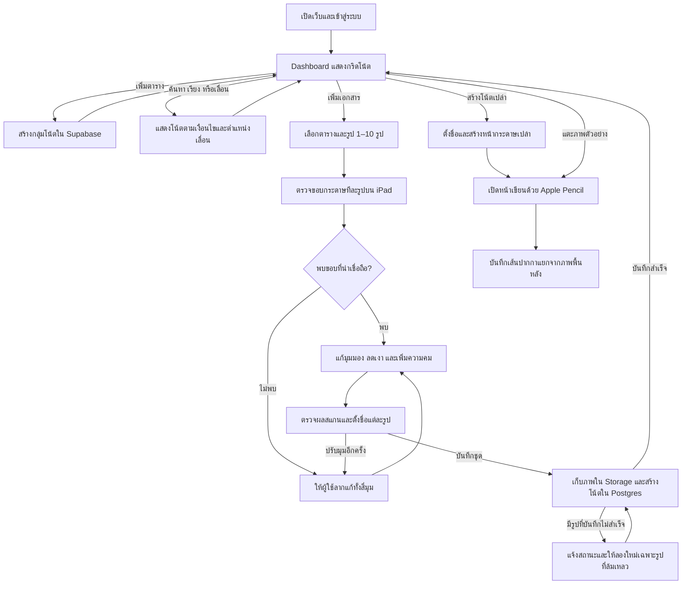

# Gods Note

Gods Note เป็นเว็บแอปจดโน้ตที่ออกแบบสำหรับ Safari บน iPad รองรับ Apple Pencil และนำเข้าภาพถ่ายเอกสารเพื่อปรับให้เหมือนภาพสแกน ข้อมูลและไฟล์เก็บใน Supabase ส่วนเว็บ deploy บน Vercel

ต้นแบบรันได้ในเครื่องทั้ง Dashboard การสแกนภาพเป็นชุด และหน้าเขียนโน้ต อ่าน [AGENTS.md](AGENTS.md) ก่อนเริ่มงานในโปรเจกต์

## รันในเครื่อง

ต้องใช้ Node.js 22 ขึ้นไป

```sh
npm ci
npm run dev
```

เปิด [Gods Note ในเครื่อง](http://localhost:3000) เมื่อยังไม่ตั้งค่า Supabase แอปจะเปิดโหมดทดลองพร้อมโน้ตตัวอย่างและเก็บข้อมูลที่เพิ่มใน IndexedDB ของเบราว์เซอร์

### เชื่อม Supabase และ deploy บน Vercel

1. เตรียมโปรเจกต์ Supabase สำหรับ Gods Note แล้วรัน SQL จากไฟล์ migration ใน SQL Editor [ไฟล์ตั้งค่าฐานข้อมูล](supabase/migrations/20261108000100_create_note_library.sql)
2. คัดลอก `.env.example` เป็น `.env.local` แล้วใส่ Project URL ใน `NEXT_PUBLIC_SUPABASE_URL` และ Publishable key ใน `NEXT_PUBLIC_SUPABASE_PUBLISHABLE_KEY`
3. นำ GitHub repository เข้า Vercel เป็นโปรเจกต์ Next.js ตั้งค่า environment variables ทั้งสองตัว แล้ว deploy
4. ตั้งค่า Site URL และ URL ที่อนุญาตให้ redirect ใน Supabase Auth ให้ตรงกับโดเมนแอป เพื่อให้ลิงก์ยืนยันบัญชีกลับมายังแอปได้

ตรวจโค้ดด้วย `npm run typecheck` และตรวจ production build ด้วย `npm run build` สคริปต์ build จะเตรียมไฟล์ OpenCV.js สำหรับสแกนภาพในเบราว์เซอร์

## ประสบการณ์ใช้งาน

### Dashboard

- หน้าหลักจัดโน้ตเป็นกริดตามกลุ่ม แต่ละกลุ่มเรียกว่า Table ปุ่ม `+ เพิ่มตาราง` อยู่เหนือพื้นที่กริด และแต่ละโน้ตแสดงชื่อไฟล์ใต้ภาพตัวอย่าง
- บน iPad แนวนอน ตั้งเป้าให้เห็นประมาณ 15 ภาพในจอแรก โดยจัด 5 คอลัมน์ × 3 แถว ปรับจำนวนคอลัมน์ตามพื้นที่จอ ผู้ใช้เลื่อนขึ้นลงเพื่อดูโน้ตและกลุ่มถัดไป
- ค้นด้วยชื่อไฟล์จากช่องค้นหาบน Dashboard ผลค้นหายังจัดตามกลุ่มเดิม
- เลือกเรียงโน้ตในแต่ละกลุ่มตามชื่อไฟล์หรือวันที่สร้าง แล้วสลับระหว่าง Ascending และ Descending วันที่สร้างอ้างอิงเวลาที่สร้างโน้ตในแอป (`created_at`)
- กด `⋯` บนการ์ด หรือแตะชื่อที่ด้านบนของหน้าเขียน เพื่อเปลี่ยนชื่อเอกสาร

### นำเข้าภาพเอกสารเป็นชุด

1. กด `+ เพิ่มเอกสาร` เลือกตารางปลายทางและเลือกรูป 1–10 รูปต่อครั้ง ถ้าเลือกเกิน 10 ให้แจ้งจำนวนสูงสุดและให้ผู้ใช้ปรับรายการก่อนดำเนินการ
2. ประมวลผลภาพทีละรูปในเบราว์เซอร์ ตรวจหาขอบและมุมกระดาษ แล้วแก้มุมมองให้หน้ากระดาษเป็นสี่เหลี่ยมตรง ลดเงา ปรับพื้นให้ขาวขึ้น และเพิ่มความคมของเส้น
3. แสดงภาพต้นฉบับคู่กับผลสแกน ผู้ใช้เลือกดูแต่ละรูป ลากแก้มุมทั้งสี่ได้ และตั้งชื่อเอกสารแยกกัน
4. แอปบีบอัดภาพสแกนและภาพย่อให้ไม่เกิน 400 KB ต่อไฟล์ก่อนอัปโหลด เมื่อกดบันทึกชุดจะสร้างหนึ่งโน้ตต่อหนึ่งรูปในตารางที่เลือก และแสดงชื่อใต้ภาพตัวอย่าง หากบันทึกบางรูปไม่สำเร็จ ผู้ใช้ลองใหม่เฉพาะรูปที่ล้มเหลวได้

### เขียนด้วย Apple Pencil

แตะภาพตัวอย่างเพื่อเปิดโน้ต แล้วเขียนบนภาพที่สแกนแล้ว หรือเริ่มจากโน้ตเปล่า ใช้ Pointer Events แยกปากกาจากการสัมผัส และใช้แรงกดเมื่ออุปกรณ์ส่งข้อมูลมา เก็บเส้นปากกาแยกจากภาพพื้นหลังโดยใช้พิกัดเทียบกับขนาดหน้า เพื่อให้เส้นอยู่ในตำแหน่งเดิมเมื่อเปลี่ยนขนาดจอหรือซูม

## สถาปัตยกรรม

| ส่วน | หน้าที่ |
| --- | --- |
| Next.js บน Vercel | ให้บริการ Dashboard หน้านำเข้าเอกสาร และหน้าเขียนโน้ต |
| OpenCV.js ใน Web Worker | ตรวจขอบกระดาษ แก้มุมมอง และปรับความสว่างกับความคมของภาพในเบราว์เซอร์ก่อนอัปโหลด |
| Canvas และ Pointer Events | แสดงหน้ากระดาษและรับเส้นจาก Apple Pencil |
| Supabase Auth | ระบุบัญชีผู้ใช้สำหรับการเข้าถึงข้อมูลและไฟล์ของตนเอง |
| Supabase Postgres | เก็บกลุ่มโน้ต ชื่อ วันที่สร้าง ข้อมูลแต่ละหน้า และเส้นปากกา |
| Supabase Storage | เก็บภาพสแกนและภาพย่อใน bucket ส่วนตัว |

### โครงสร้างข้อมูล

| ตาราง | ข้อมูลและความสัมพันธ์ |
| --- | --- |
| `collections` | กลุ่มโน้ต มีรหัสเจ้าของและชื่อกลุ่ม |
| `notes` | ชื่อโน้ต วันที่สร้าง และพาธภาพปก อยู่ภายใต้ `collections` |
| `note_pages` | ลำดับหน้า พาธภาพพื้นหลัง และข้อมูลเส้นปากกา อยู่ภายใต้ `notes` |

ใช้ Row Level Security (RLS) ใน Postgres และนโยบายของ Storage จำกัดการอ่านและแก้ไขตามเจ้าของบัญชี เบราว์เซอร์ส่งภาพที่ผู้ใช้ยืนยันไปยัง Supabase Storage โดยตรง

## Flowchart



## บล็อกงานพัฒนา

1. ตั้งโครง Next.js, Supabase Auth, ฐานข้อมูล และ Dashboard ที่เพิ่มตาราง ค้นหา เรียง และเลื่อนดูโน้ตได้
2. ทำการนำเข้าภาพเป็นชุด ตรวจขอบ แก้มุม ปรับภาพ ตั้งชื่อ และบันทึกลงตาราง
3. ทำหน้าเขียนและการบันทึกเส้นปากกา ทดสอบบน Safari ด้วย iPad และ Apple Pencil จริง แล้ว deploy บน Vercel
