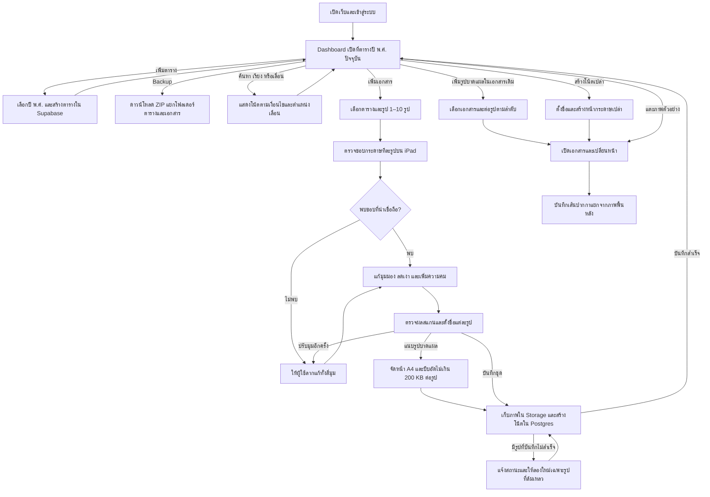

# Gods Note

Gods Note เป็นเว็บแอปจดโน้ตที่ออกแบบสำหรับ Safari บน iPad รองรับ Apple Pencil และนำเข้าภาพถ่ายเอกสารเพื่อปรับให้เหมือนภาพสแกน ข้อมูลและไฟล์เก็บใน Supabase ส่วนเว็บ deploy บน Vercel

จัดเอกสารตามปี พ.ศ. สแกนเอกสารเป็นชุด แนบรูปบาดแผลเป็นหน้าต่อ และดาวน์โหลด Backup เป็น JPG พร้อมลายเขียน อ่าน [AGENTS.md](AGENTS.md) ก่อนเริ่มงานในโปรเจกต์

## รันในเครื่อง

ต้องใช้ Node.js 22 ขึ้นไป

```sh
npm ci
npm run dev
```

เปิด [Gods Note ในเครื่อง](http://localhost:3000) เมื่อยังไม่ตั้งค่า Supabase แอปจะเปิดโหมดทดลองพร้อมโน้ตตัวอย่างและเก็บข้อมูลที่เพิ่มใน IndexedDB ของเบราว์เซอร์

### เชื่อม Supabase และ deploy บน Vercel

1. เตรียมโปรเจกต์ Supabase สำหรับ Gods Note แล้วใช้ Supabase CLI หรือ SQL Editor เพื่อรัน migration ที่ยังไม่ได้ใช้ตามลำดับ [ไฟล์ตั้งค่าฐานข้อมูล](supabase/migrations)
2. คัดลอก `.env.example` เป็น `.env.local` แล้วใส่ Project URL ใน `NEXT_PUBLIC_SUPABASE_URL` และ Publishable key ใน `NEXT_PUBLIC_SUPABASE_PUBLISHABLE_KEY`
3. นำ GitHub repository เข้า Vercel เป็นโปรเจกต์ Next.js ตั้งค่า environment variables ทั้งสองตัว แล้ว deploy
4. ตั้งค่า Site URL และ URL ที่อนุญาตให้ redirect ใน Supabase Auth ให้ตรงกับโดเมนแอป เพื่อให้ลิงก์ยืนยันบัญชีกลับมายังแอปได้

ตรวจโค้ดด้วย `npm run typecheck` และตรวจ production build ด้วย `npm run build` สคริปต์ build จะเตรียมไฟล์ OpenCV.js สำหรับสแกนภาพในเบราว์เซอร์

### อัปเดตโปรเจกต์ที่ใช้งานอยู่

สำหรับโปรเจกต์ที่เชื่อมกับ Supabase CLI แล้ว ให้ตรวจรายการด้วย `supabase migration list --linked` และรัน `supabase db push --linked` ก่อน push เวอร์ชันนี้ขึ้น `main` เพื่อให้ Vercel deploy หลังจากฐานข้อมูลพร้อมใช้งาน [Migration สำหรับตารางปีและหน้ารูปบาดแผล](supabase/migrations/20261110000100_year_tables_and_wound_pages.sql)

## ประสบการณ์ใช้งาน

### Dashboard

- หน้าแรกเปิดที่ปี พ.ศ. ปัจจุบันตามเวลาไทย หากยังไม่มีตารางของปีนั้น ให้กด **Add table** แล้วกด **Create** ปุ่มนี้เลือกปีปัจจุบันไว้ก่อนและเลือกปีอื่นได้ถึง พ.ศ. 2600 ตารางชื่อเดิมเปิดได้จากแถบด้านข้างหรือ **All notes**
- แต่ละตารางแสดงโน้ตเป็นกริดพร้อมชื่อไฟล์ใต้ภาพตัวอย่าง
- บน iPad แนวนอน ตั้งเป้าให้เห็นประมาณ 15 ภาพในจอแรก โดยจัด 5 คอลัมน์ × 3 แถว ปรับจำนวนคอลัมน์ตามพื้นที่จอ ผู้ใช้เลื่อนขึ้นลงเพื่อดูโน้ตและกลุ่มถัดไป
- ค้นด้วยชื่อไฟล์จากช่องค้นหาบน Dashboard ผลค้นหายังจัดตามกลุ่มเดิม
- เลือกเรียงโน้ตในแต่ละกลุ่มตามชื่อไฟล์หรือวันที่สร้าง แล้วสลับระหว่าง Ascending และ Descending วันที่สร้างอ้างอิงเวลาที่สร้างโน้ตในแอป (`created_at`)
- กด `⋯` บนการ์ดเพื่อเลือก **Rename** หรือ **Delete** แอปจะขอยืนยันก่อนลบเอกสาร ในหน้าเขียนให้แตะชื่อด้านบนเพื่อเปลี่ยนชื่อ
- ชื่อเอกสารต้องไม่ซ้ำกันในบัญชีเดียวกัน แม้อยู่คนละตาราง โดยเปรียบเทียบชื่อหลังตัดช่องว่างหัวท้ายและไม่แยกตัวพิมพ์ใหญ่กับตัวพิมพ์เล็ก

### นำเข้าภาพเอกสารเป็นชุด

1. กด **Add documents → Upload documents** เลือกตารางปลายทางและเลือกรูป รวมภาพสแกนและรูปบาดแผลได้สูงสุด 10 รูปต่อชุด
2. ประมวลผลภาพทีละรูปในเบราว์เซอร์ ตรวจหาขอบและมุมกระดาษ แล้วแก้มุมมองให้หน้ากระดาษเป็นสี่เหลี่ยมตรง ลดเงา ปรับพื้นให้ขาวขึ้น และเพิ่มความคมของเส้น
3. แสดงภาพต้นฉบับคู่กับผลสแกน ผู้ใช้เลือกดูแต่ละรูป ลากแก้มุมทั้งสี่ได้ และตั้งชื่อเอกสารแยกกัน
4. แอปบีบอัดภาพสแกนและภาพย่อให้ไม่เกิน 400 KB ต่อไฟล์ก่อนอัปโหลด เมื่อกดบันทึกชุดจะสร้างหนึ่งโน้ตต่อหนึ่งรูปในตารางที่เลือก และแสดงชื่อใต้ภาพตัวอย่าง หากบันทึกบางรูปไม่สำเร็จ ผู้ใช้ลองใหม่เฉพาะรูปที่ล้มเหลวได้

### หน้ารูปบาดแผล

- ในหน้าอัปโหลดเอกสาร กด **Add wound photos** ใต้รูปสแกนของเอกสารที่ต้องการ รูปบาดแผลจะเป็นหน้า 2, 3, 4 ต่อจากหน้าเอกสารตามลำดับที่เลือก
- หากมีเอกสารอยู่แล้ว ให้กด **Add documents → Upload wound photos** แล้วเลือกเอกสารปลายทาง รูปใหม่จะต่อจากหน้าสุดท้าย
- แอปวางรูปตามสัดส่วนลงบนหน้า A4 แนวตั้งและบีบอัด JPG ให้ไม่เกิน 200 KB ต่อรูป

### เขียนด้วย Apple Pencil

แตะภาพตัวอย่างเพื่อเปิดโน้ต ใช้ลูกศรเปลี่ยนหน้าในเอกสารหลายหน้า ลายเขียนบันทึกแยกตามหน้า ใช้ Pointer Events แยกปากกาจากการสัมผัส และใช้แรงกดเมื่ออุปกรณ์ส่งข้อมูลมา เก็บเส้นปากกาแยกจากภาพพื้นหลังโดยใช้พิกัดเทียบกับขนาดหน้า เพื่อให้เส้นอยู่ในตำแหน่งเดิมเมื่อเปลี่ยนขนาดจอหรือซูม

### Backup

กด **Backup → Download ZIP** เพื่อดาวน์โหลดทุกตาราง ภายใน ZIP แยกโฟลเดอร์ตามตารางและชื่อเอกสาร และเรียงหน้าเป็น `001.jpg`, `002.jpg` ต่อไป ไฟล์ JPG รวมภาพพื้นหลังกับลายเขียนที่บันทึกไว้

```text
gods-note-backup.zip
└── พ.ศ. 2569/
    └── ชื่อเอกสาร/
        ├── 001.jpg
        ├── 002.jpg
        └── 003.jpg
```

## สถาปัตยกรรม

| ส่วน | หน้าที่ |
| --- | --- |
| Next.js บน Vercel | ให้บริการ Dashboard หน้านำเข้าเอกสาร และหน้าเขียนโน้ต |
| OpenCV.js ใน Web Worker | ตรวจขอบกระดาษ แก้มุมมอง และปรับความสว่างกับความคมของภาพในเบราว์เซอร์ก่อนอัปโหลด |
| Canvas และ Pointer Events | แสดงหน้ากระดาษและรับเส้นจาก Apple Pencil |
| Supabase Auth | ระบุบัญชีผู้ใช้สำหรับการเข้าถึงข้อมูลและไฟล์ของตนเอง |
| Supabase Postgres | เก็บกลุ่มโน้ต ชื่อ วันที่สร้าง ข้อมูลแต่ละหน้า และเส้นปากกา |
| Supabase Storage | เก็บภาพสแกน ภาพย่อ และหน้ารูปบาดแผลใน bucket ส่วนตัว |

### โครงสร้างข้อมูล

| ตาราง | ข้อมูลและความสัมพันธ์ |
| --- | --- |
| `collections` | กลุ่มโน้ต มีรหัสเจ้าของ ชื่อกลุ่ม และปี พ.ศ. สำหรับตารางปี |
| `notes` | ชื่อโน้ต วันที่สร้าง และพาธภาพปก อยู่ภายใต้ `collections` |
| `note_pages` | ลำดับหน้า ประเภทหน้า พาธภาพพื้นหลัง และข้อมูลเส้นปากกา อยู่ภายใต้ `notes` |

ใช้ Row Level Security (RLS) ใน Postgres และนโยบายของ Storage จำกัดการอ่านและแก้ไขตามเจ้าของบัญชี เบราว์เซอร์ส่งภาพที่ผู้ใช้ยืนยันไปยัง Supabase Storage โดยตรง

## Flowchart



## ตรวจหลัง deploy

1. เปิดหน้าแรกและตรวจว่าแสดงปี พ.ศ. ปัจจุบัน เปิดเอกสารจากตารางเดิมผ่าน **All notes** ได้
2. นำเข้าภาพสแกนพร้อมรูปบาดแผล เปิดเอกสาร แล้วตรวจลำดับหน้าและการบันทึกลายเขียนด้วย Apple Pencil บน iPad
3. ดาวน์โหลด ZIP และตรวจว่า JPG ของแต่ละหน้าอยู่ใต้โฟลเดอร์ตารางและชื่อเอกสารที่ถูกต้อง
